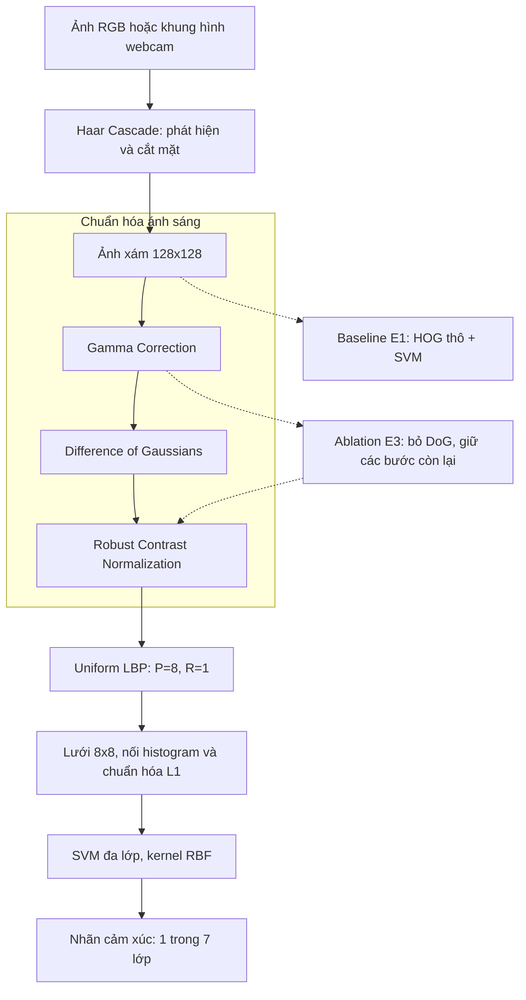

# TÀI LIỆU THIẾT KẾ KIẾN TRÚC PIPELINE KỸ THUẬT

- **Motivation/Background**: Đồng bộ kiến trúc với đề tài nhận diện cảm xúc.
- **Purpose**: Thiết kế FER 7 lớp trong điều kiện ánh sáng không đồng đều.
- **Overview Pipeline**: Cắt mặt → Gamma → DoG → chuẩn hóa tương phản → Spatial-LBP → SVM.
- **Detailed Plan**: Kiến trúc, module, dữ liệu, E1–E4 và giao diện triển khai dự kiến.
- **References**: [Bản đề tài](DE_TAI_FACEID_EMOTION.md), [hướng dẫn BTL](TOM_TAT_HUONG_DAN_BTL.md), [quy ước Markdown](agents/rules/MD_CONVENTION.md).
- **Created**: 2026-11-23T23:07:16+07:00
- **Last Updated**: 2026-11-25T16:30:28+07:00

---

**Đề tài:** Nhận diện cảm xúc khuôn mặt trong điều kiện ánh sáng không đồng đều  
**Môn học:** Xử Lý Ảnh và Thị Giác Máy Tính (121036)  
**Trường:** Đại học Giao thông Vận tải TP. Hồ Chí Minh (UTH)

**Trạng thái:** Đã triển khai backend FastAPI, giao diện thử ảnh tại `/`, pipeline FER, CLI huấn luyện và kiểm thử. Frontend HTML/CSS/JavaScript nằm trong [thư mục static](src/api/static/), dùng cùng cổng và API backend. Chưa có dữ liệu thực tế, model đã huấn luyện hoặc kết quả E1–E4. Hướng dẫn chạy hiện tại xem [README](README.md); phần thí nghiệm bên dưới vẫn là thiết kế dự kiến.

## 1. TỔNG QUAN KIẾN TRÚC

Pipeline nối tiếp nhận ảnh hoặc khung hình webcam, cắt vùng mặt rồi phân loại 7 cảm xúc. Khối chuẩn hóa ánh sáng nhằm giảm ảnh hưởng của ánh sáng không đồng đều và bóng đổ gắt ($C$).



---

## 2. CHI TIẾT MODULE

### 2.1. Thu nhận và chuẩn hóa hình học

- Đầu vào: ảnh RGB hoặc khung hình webcam; demo xét một khuôn mặt gần trực diện, không che khuất.
- Haar Cascade chỉ là tiện ích phát hiện mặt; cắt ROI rồi chuyển ảnh xám theo $Y=0.299R+0.587G+0.114B$ và resize song tuyến về $128\times128$.
- Dùng cùng cách cắt mặt cho baseline và phương pháp đề xuất. Demo báo lỗi nếu ảnh không đọc được, không có mặt hoặc có nhiều mặt; không xuất nhãn trong các trường hợp này. Khi đánh giá, báo cáo cả số ca phát hiện mặt thất bại.
- Với ảnh mặt đã cắt như FER2013, chọn chế độ `cropped_faces=true` để chuyển xám và resize nguyên ảnh bằng cùng hàm chuẩn bị lúc train. Chế độ này bỏ qua detector, không xác minh số mặt và trả vùng xử lý bằng toàn ảnh. Không tự chuyển sang chế độ này khi phát hiện mặt thất bại trên ảnh toàn cảnh.

### 2.2. Chuẩn hóa ánh sáng

Theo mô hình gần đúng $I(x,y)=L(x,y)R(x,y)$, chuỗi xử lý nhằm giảm ảnh hưởng chiếu sáng $L$ và giữ chi tiết biểu cảm trong $R$. Không giả định phục hồi được chi tiết đã mất do clipping.

**Bước 1 — Gamma Correction:**

$$I_\gamma(x,y)=255\left(\frac{I(x,y)}{255}\right)^\gamma$$

Khởi đầu với $\gamma=0.2$; chọn giá trị cuối qua E2. Với $\gamma<1$, bước này nâng vùng tối và nén dải động.

**Bước 2 — Difference of Gaussians:**

$$I_{DoG}=G_{\sigma_1}*I_\gamma-G_{\sigma_2}*I_\gamma,\qquad \sigma_1<\sigma_2$$

Khởi đầu với $\sigma_1=1.0$, $\sigma_2=4.0$, kernel $17\times17$. Phép trừ giảm thành phần tần số thấp; làm mịn giảm nhiễu tần số cao. Ranh giới bóng đổ gắt vẫn có thể tồn tại trong dải tần biểu cảm.

**Bước 3 — Robust Contrast Normalization:**

$$I_1=\frac{I_{DoG}}{\max\left(\left(\operatorname{mean}|I_{DoG}|^\alpha\right)^{1/\alpha},\epsilon\right)}$$

$$I_2=\frac{I_1}{\max\left(\left(\operatorname{mean}\min(\tau,|I_1|)^\alpha\right)^{1/\alpha},\epsilon\right)}$$

$$I_{norm}=127.5\left(\tanh(I_2/\tau)+1\right)$$

Dùng $\alpha=0.1$, $\tau=10$, $\epsilon=10^{-8}$. Tính DoG và chuẩn hóa trên số thực có dấu để giữ phần âm và tránh chia cho 0. Không thêm CLAHE vào pipeline mặc định.

### 2.3. Spatial Uniform LBP

$$LBP_{P,R}=\sum_{p=0}^{P-1}s(g_p-g_c)2^p,\qquad s(z)=\begin{cases}1&z\ge0\\0&z<0\end{cases}$$

- Mặc định $P=8$, $R=1$. Dùng ánh xạ uniform giữ riêng 58 mẫu có tối đa 2 lần chuyển bit trên vòng tròn, gom các mẫu còn lại vào bin thứ 59; không dùng ánh xạ uniform bất biến xoay 10 bins.
- Chia ảnh thành lưới $8\times8$, mỗi ô $16\times16$ pixel. Nối 64 histogram 59 bins thành $H_{face}\in\mathbb{R}^{3776}$.
- Chuẩn hóa vector L1; vector toàn 0 giữ nguyên. LBP giữ thứ tự so sánh dưới biến đổi đơn điệu tăng nghiêm ngặt áp dụng chung cho các pixel, không bảo đảm bất biến với bóng đổ cục bộ hoặc nhiễu.

### 2.4. Phân loại cảm xúc bằng SVM

$$K(x,x')=\exp(-\gamma_{svm}\|x-x'\|^2)$$

- Huấn luyện SVM kernel RBF bằng scikit-learn trên tập phát triển, dùng One-vs-One cho 7 lớp; chọn tham số qua validation trong tập phát triển.
- Đầu ra: một nhãn trong **Neutral (Bình thường), Happiness (Vui vẻ), Sadness (Buồn bã), Surprise (Ngạc nhiên), Anger (Giận dữ), Disgust (Ghê tởm), Fear (Sợ hãi)**. Không thêm Softmax vào SVM.
- Nhãn mô tả biểu cảm quan sát được, không kết luận mức độ chú ý hoặc trạng thái tâm lý.

---

## 3. DỮ LIỆU VÀ THÍ NGHIỆM E1–E4

Nguồn dự kiến gồm RAF-DB và ảnh tự chụp có nhãn 7 cảm xúc. Cách chia tập 70/30, phân tầng $C_1,C_2,C_3$ và giả định thu nhận theo [bản đề tài](DE_TAI_FACEID_EMOTION.md). Giữ ảnh cùng người/phiên chụp trong cùng tập khi có thông tin nhóm; chia tập trước khi tạo biến thể ánh sáng.

| Thí nghiệm | Thực hiện | Kết quả cần báo cáo |
| :--- | :--- | :--- |
| **E1: Kiểm chứng thách thức** | HOG thô + SVM trên từng tầng ánh sáng | Accuracy, Macro-F1, thời gian xử lý và 3 ca lỗi tiêu biểu nếu có; kiểm tra giả thuyết hiệu năng giảm khi ánh sáng khó hơn |
| **E2: Khảo sát tham số** | Gamma trong {0.1, 0.2, 0.5, 1.0}; DoG với sigma1 trong {1, 1.5, 2}, sigma2 trong {2, 4, 8}, sigma1 < sigma2; LBP (8,1) so với (16,2) | Chọn cấu hình trên validation, thay đổi một yếu tố mỗi lượt; xuất ảnh sau từng bước |
| **E3: Ablation** | Lần lượt bỏ DoG, bỏ toàn bộ chuẩn hóa ánh sáng, thay Spatial-LBP bằng histogram toàn cục | Chênh lệch Accuracy và Macro-F1 so với pipeline đầy đủ trên cùng tập đánh giá; giữ split và cấu hình SVM cố định, huấn luyện lại cho mỗi biểu diễn |
| **E4: Điểm thất bại** | Giảm sáng ảnh đánh giá tới mức pixel trung bình {20, 15, 10, 5, 2, 0}, tăng bóng tối nhân tạo | Đường cong chỉ số theo mức suy giảm và ca mất chi tiết; không đặt trước ngưỡng thất bại hoặc quy đổi pixel thành lux |

Không huấn luyện lại hoặc điều chỉnh tham số từ kết quả tập đánh giá. Các con số trong cấu hình là mức thử nghiệm dự kiến, không phải kết quả đã đo.

---

## 4. CẤU TRÚC TRIỂN KHAI DỰ KIẾN

Các module xử lý ảnh, huấn luyện và API đã tồn tại; các script E1–E4 và notebook trong cây vẫn là phần dự kiến.

```text
Computor-Vision_FinalLab/
├── docs/
│   └── Computer_Vision 32.pdf
├── DE_TAI_FACEID_EMOTION.md        # Bản đề tài FER, giữ tên file cũ
├── PIPELINE_ARCHITECTURE.md
├── requirements.txt               # OpenCV, scikit-learn, NumPy, SciPy
├── requirements-dev.txt           # Công cụ kiểm thử và lint
├── models/                        # Model SVM cục bộ, không commit
├── data/
│   ├── raw/                       # RAF-DB và ảnh tự chụp có nhãn cảm xúc
│   ├── processed/                 # train, validation, evaluation
│   ├── stratified/                # C1_uniform, C2_sidelight, C3_harsh
│   └── sample_test/
├── src/
│   ├── __init__.py
│   ├── api/
│   │   └── main.py                # FastAPI: health, emotions, predict
│   ├── preprocessing/
│   │   ├── face_crop.py
│   │   ├── gamma_correction.py
│   │   ├── dog_filter.py
│   │   └── contrast_equalization.py
│   ├── feature_extraction/
│   │   └── lbp_descriptor.py
│   ├── emotion_recognition/
│   │   └── svm_fer_classifier.py
│   ├── training/
│   │   └── train.py               # Huấn luyện SVM từ thư mục 7 nhãn
│   └── pipeline.py
├── experiments/
│   ├── run_experiment_E1.py
│   ├── run_experiment_E2.py
│   ├── run_experiment_E3.py
│   └── run_experiment_E4.py
├── notebooks/
│   └── experiment_analysis.ipynb
├── tests/
└── README.md
```

---

## 5. LỆNH CHẠY BACKEND VÀ THÍ NGHIỆM DỰ KIẾN

Backend và CLI đã có mã nguồn. Cần chuẩn bị dữ liệu có nhãn để huấn luyện trước khi dự đoán; API chưa có model trả HTTP 503. Bốn lệnh thí nghiệm cuối mục vẫn là minh họa, chưa được triển khai.

### Môi trường Windows

```powershell
python -m venv .venv
.venv\Scripts\python -m pip install -r requirements-dev.txt
.venv\Scripts\python -m uvicorn src.api.main:app --host 127.0.0.1 --port 8000
```

### Demo nhận diện cảm xúc

```powershell
.venv\Scripts\python -m src.training.train --data-dir data/processed/train
.venv\Scripts\python -m src.pipeline --input data/sample_test/sample_face.jpg
```

### Bốn thí nghiệm

```powershell
# E1: HOG + SVM trên ba tầng ánh sáng
python experiments/run_experiment_E1.py --data_dir data/stratified

# E2: Khảo sát tham số và xuất ảnh trung gian
python experiments/run_experiment_E2.py --output_dir experiments/results/E2_params

# E3: Minh họa biến thể bỏ DoG; chạy các biến thể còn lại theo mục 3
python experiments/run_experiment_E3.py --disable_dog True

# E4: Mức sáng trung bình theo pixel, không phải lux
python experiments/run_experiment_E4.py --brightness_levels 20 15 10 5 2 0
```
