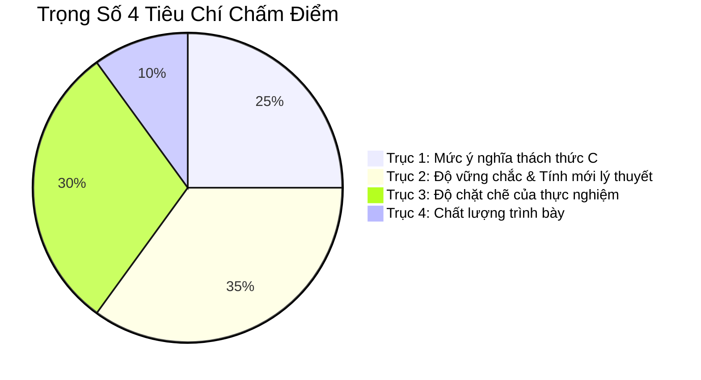

# TÓM TẮT HƯỚNG DẪN BÀI TẬP LỚN
## MÔN HỌC: XỬ LÝ ẢNH VÀ THỊ GIÁC MÁY TÍNH (121036)
**Trường Đại học Giao thông Vận tải TP. Hồ Chí Minh (UTH)**  
*Số tín chỉ:* 3 | *Trọng số:* 50% điểm tổng kết

---

## 1. THÔNG TIN CHUNG & CƠ CẤU ĐIỂM

| Sản phẩm nộp | Mô tả chi tiết | Trọng số |
| :--- | :--- | :---: |
| **Mã nguồn (Source code)** | Cài đặt đầy đủ: Baseline + Phương pháp đề xuất + Script chạy 4 thí nghiệm (E1–E4) + README cài đặt + Dữ liệu mẫu (hoặc link tải) + Tệp mô tả phân tầng. Viết bằng Python (OpenCV, scikit-image, PIL...). Kèm Jupyter Notebook nếu chọn trình bày ở đây. | **25%** |
| **Báo cáo (Report)** | Độ dài 6–15 trang văn bản (không tính hình ảnh, bảng biểu), tuân theo cấu trúc 12 mục chuẩn, trích dẫn IEEE. | **25%** |
| **Thuyết trình (Presentation)** | Trình bày trực tiếp trên lớp và trả lời phiên hỏi đáp (Q&A). | **50%** |
| **Tổng cộng** | | **100%** |

---

## 2. TRIẾT LÝ CHẤM ĐIỂM: BÀI TẬP LỚN NÀY ĐO CÁI GÌ?

> [!IMPORTANT]
> **Điểm số KHÔNG đo:** Khả năng "xây được một ứng dụng chạy được" bằng các mô hình dựng sẵn (gọi vài dòng lệnh thư viện, kéo thả giao diện, import mô hình pre-trained).  
> **Điểm số ĐO:** Mức độ hiểu sâu kỹ thuật thị giác máy tính thể hiện qua việc nhóm **đối mặt và vượt qua một THÁCH THỨC THỰC TẾ ($C$)** trên bộ ảnh thực tế bằng **KỸ THUẬT CÓ LÝ THUYẾT RÕ RÀNG ($P$)**.

* **Công thức cốt lõi:**
  > *"Trong công việc [...], trên bộ ảnh thực tế, thách thức $C$ tạo ra hạn chế $F$. Nhóm đề xuất kỹ thuật $P$; dựa trên lý thuyết, $P$ khắc phục được $C$ vì [cơ chế]; và nhóm chứng minh bằng thực nghiệm rằng $P$ làm được điều đó — cũng như chỉ ra $P$ bắt đầu ngừng hoạt động ở đâu."*

* **Sự đánh đổi cần biết trước:**
  - Chọn thách thức tầm thường/ảnh quá dễ $\rightarrow$ mất điểm Trục 1 & Trục 2.
  - Chọn thách thức lớn nhưng chỉ "thử vài thuật toán xem cái nào chạy được" $\rightarrow$ mất điểm Trục 2 & Trục 3.
  - **Trục 2 có trọng số lớn nhất (35%):** Lý do nhóm tin rằng $P$ sẽ thắng $C$ quan trọng hơn việc $P$ có thắng hay không.
  - **Không đánh bại được baseline vẫn đạt điểm cao:** Nếu nhóm có lập luận thuyết phục, phân tích nguyên nhân và chẩn đoán cơ chế thất bại nghiêm túc.

---

## 3. BA TRỤC ĐÁNH GIÁ CỐT LÕI



### Trục 1: Mức ý nghĩa của thách thức $C$ (25%)
- Thách thức $C$ phải có thật, xuất hiện rõ trong dữ liệu thực tế.
- Thuộc một trong các chiều khó tiêu chuẩn.
- **Phải được chứng minh bằng thực nghiệm là làm gãy cách làm thông thường (baseline)**, không được chỉ nói bằng lời.

### Trục 2: Độ vững chắc & Tính mới của lý thuyết (35%)
- Lập luận ở mức cơ chế (tác động lên đại lượng vật lý/toán học nào trong ảnh).
- Kết nối chặt chẽ về nền tảng môn học (Chương 2, 3, 4, 5).
- Có **dự đoán điểm gãy** trước khi chạy thực nghiệm.
- **Thang đánh giá tính mới:**
  - *Mức 0 (Rất thấp):* Áp dụng nguyên xi thuật toán mặc định, chép code có sẵn.
  - *Mức 1 (Trung bình):* Tinh chỉnh tham số theo đặc điểm của $C$, có lý giải.
  - *Mức 2 (Cao):* Sửa đổi bước thuật toán, ghép 2 kỹ thuật để bù trừ khuyết điểm, chuyển ngữ cảnh kèm lập luận cơ chế.
  - *Mức 3 (Tối đa):* Kèm suy dẫn định lượng dự đoán hành vi (điểm gãy, điều kiện đủ) và kiểm chứng thực nghiệm đúng dự đoán.

> [!CAUTION]
> **Quy định về Hàm/Mô hình dựng sẵn:**  
> - Các hàm/mô hình dựng sẵn (như `detectMultiScale/Haar`, detector dựng sẵn, mô hình deep learning có sẵn) **CHỈ ĐƯỢC DÙNG LÀM TIỆN ÍCH** (crop vùng quan tâm) hoặc làm **BASELINE**.
> - **KHÔNG ĐƯỢC** tính vào Trục 2 và **KHÔNG ĐƯỢC** là thành phần nhóm nêu để khắc phục thách thức $C$.

### Trục 3: Độ chặt chẽ của phương pháp thực nghiệm (30%)
- Dữ liệu đánh giá bắt buộc phải **phân tầng theo cường độ $C$** (ít nhất 3 mức).
- Đánh giá bằng thước đo định lượng (không đánh giá bằng mắt).
- Hoàn thành đầy đủ **4 thí nghiệm bắt buộc (E1–E4)**.
- Phân tích thất bại trung thực, khách quan.

### Trục 4: Chất lượng trình bày (10%)
- Báo cáo mạch lạc, hình ảnh rõ nét, thuyết trình tự tin, trả lời Q&A vững vàng, trích dẫn IEEE đúng chuẩn.

---

## 4. BỘ BA XÁC ĐỊNH ĐỀ TÀI & CÁC CHIỀU KHÓ

Một đề tài hợp lệ bắt buộc xác định bởi bộ ba:
$$\text{Đề tài} = \langle \text{Tác vụ} + \text{Dữ liệu thực tế} + \text{Thách thức chính } C \rangle$$

### 6 Chiều khó tiêu chuẩn:
1. **Ánh sáng:** Sáng/tối không đều, bóng đổ, tương phản thay đổi, ngược sáng.
2. **Che khuất:** Đối tượng bị che một phần bởi vật khác hoặc bởi chính nó.
3. **Góc nhìn & Tỷ lệ:** Cùng vật thể ở nhiều góc quay, khoảng cách, kích thước.
4. **Nhiễu & Mờ:** Nhiễu hạt cảm biến, mờ do chuyển động (motion blur), mất nét (defocus blur), nén ảnh.
5. **Nền lộn xộn:** Nền phức tạp, nhiều vật thể gây nhiễu, khó tách biên đối tượng.
6. **Biến thiên nội lớp:** Cùng một loại đối tượng nhưng khác nhau nhiều về kiểu dáng, màu sắc, hình học.

> [!TIP]
> **Quy tắc thu hẹp bài toán:**  
> Cố định các chiều khó không phải $C$ bằng **giả định hợp lý** (ví dụ: cố định góc camera để loại bỏ chiều góc nhìn), nhằm dồn toàn lực giải quyết chiều khó duy nhất $C$.

### Khi nào đề tài bị xem là "Quá đơn giản" (bị trừ điểm nặng)?
1. **Thách thức bị gỡ bỏ trước khi bắt đầu:** Ảnh đầu vào đã được làm sạch, cắt sẵn, ánh sáng studio quá đẹp.
2. **Baseline đơn giản đã giải xong:** Phương pháp tầm thường (ngưỡng pixel, template matching thô) đã đạt kết quả gần hoàn hảo $\rightarrow$ $C$ không phải thách thức thật.
3. **Các bước trong pipeline không "chịu lực":** Nếu xóa bỏ bước được cho là giải quyết $C$ mà kết quả đo vẫn không đổi $\rightarrow$ bước đó là vô dụng.

---

## 5. TUYÊN BỐ THÁCH THỨC (CẤU TRÚC 3 PHẦN BẮT BUỘC)

Mỗi nhóm bắt buộc phải có một bản tuyên bố gồm 3 phần:

```text
PHẦN A: BỐI CẢNH VÀ THÁCH THỨC
├── 1. Tác vụ: Đang giải quyết bài toán gì, phục vụ ai?
├── 2. Dữ liệu: Lấy từ đâu, điều kiện thu thập thực tế ra sao?
├── 3. Thách thức C: Chiều khó cụ thể nào đang làm bài toán khó?
├── 4. Kiểu hạn chế F: Cách làm thông thường (baseline) ngừng hoạt động ra sao?
└── 5. Giả định thu hẹp: Cố định các chiều khó nào khác và lý giải vì sao chấp nhận được?

PHẦN B: LÝ THUYẾT CỦA GIẢI PHÁP
├── 1. Kỹ thuật P: Đề xuất dùng kỹ thuật gì thay cho cách làm thông thường?
├── 2. Cơ chế: Vì sao P giải quyết được C? Nối về nền tảng môn học (Chương 2, 3, 4, 5).
└── 3. Dự đoán điểm thất bại: Theo lý thuyết, P sẽ gãy khi nào? (Viết TRƯỚC thí nghiệm).

PHẦN C: TIÊU CHÍ KIỂM CHỨNG
├── 1. Thước đo định lượng: Accuracy, IoU, F1-score, sai số định vị, độ trễ xử lý...
└── 2. Baseline: Cách làm thông thường nào dùng làm mốc so sánh?
```

---

## 6. DỮ LIỆU THỰC TẾ & NGUYÊN TẮC PHÂN TẦNG

1. **Nguồn dữ liệu:** Tự chụp tại hiện trường HOẶC sử dụng bộ dữ liệu công khai (có trích dẫn IEEE và giấy phép).
2. **Quy mô:** Phải tách biệt rõ ràng giữa **Tập phát triển (Development set)** và **Tập đánh giá (Evaluation set)**. Tuyệt đối không tinh chỉnh tham số trên tập đánh giá.
3. **Phân tầng (Bắt buộc ít nhất 3 mức):**
   - *Tầng 1 (Nhẹ):* Cường độ thách thức $C$ thấp.
   - *Tầng 2 (Trung bình):* Cường độ thách thức $C$ trung bình.
   - *Tầng 3 (Nặng):* Cường độ thách thức $C$ khắc nghiệt.
   - *Mục đích:* Chứng minh đường cong suy giảm: khi $C$ tăng dần, baseline tụt dốc thảm hại, còn phương pháp $P$ vẫn đứng vững hoặc tụt chậm hơn nhiều.

---

## 7. BỐN THÍ NGHIỆM BẮT BUỘC (E1 – E4)

| Mã | Tên thí nghiệm | Yêu cầu thực hiện |
| :---: | :--- | :--- |
| **E1** | **Chứng cứ thách thức** | Chạy baseline trên tập đánh giá đã phân tầng. Báo cáo chỉ số tụt dốc theo từng tầng và đưa ra **ít nhất 3 ảnh thất bại tiêu biểu**. Chứng minh nguyên nhân hỏng là do $C$. |
| **E2** | **Khảo sát tham số** | Chọn ít nhất 1 tham số cốt lõi của mỗi kỹ thuật chính (ngưỡng, kích thước kernel, số cụm...). Chạy **ít nhất 3 giá trị tham số**, trình bày chỉ số và nhận xét lý thuyết. **Bắt buộc xuất ảnh trung gian qua từng bước pipeline**. |
| **E3** | **Loại bỏ thành phần (Ablation)** | Tắt/gỡ bỏ thành phần được cho là giải quyết $C$, giữ nguyên các bước còn lại. Đo lại: nếu chỉ số sụt giảm mạnh về gần baseline $\Rightarrow$ thành phần đó thực sự chịu lực. |
| **E4** | **Kiểm tra điểm gãy (Failure point)** | Tăng dần cường độ $C$ (làm nặng có kiểm soát) cho đến khi phương pháp $P$ bắt đầu gãy/hoạt động kém. Báo cáo ngưỡng gãy quan sát được và **đối chiếu với dự đoán lý thuyết ở Phần B**. |

---

## 8. CẤU TRÚC BÁO CÁO CHUẨN (12 MỤC)
*(Giới hạn: 6–15 trang văn bản, không tính hình ảnh, bảng biểu)*

1. **Đặt vấn đề:** Tác vụ, động lực thực tế, Tuyên bố thách thức đầy đủ (Phần A/B/C).
2. **Dữ liệu:** Nguồn gốc, quy mô, tiêu chí định lượng phân tầng $C$, cách gán nhãn ground-truth.
3. **Công trình liên quan:** Ít nhất 3 bài báo/hệ thống hiện có (nêu rõ kế thừa chỗ nào, khác biệt chỗ nào).
4. **Phân tích thách thức:** Kết quả E1 (baseline gãy ở đâu theo từng tầng, kèm ảnh lỗi).
5. **Cơ sở lý thuyết của giải pháp:** Cơ chế vì sao $P$ khắc phục được $C$, nối về Chương 2–5, vị trí tính mới, dự đoán điểm gãy.
6. **Phương pháp:** Sơ đồ pipeline toàn diện và lý giải cho từng bước thiết kế.
7. **Thiết lập thực nghiệm:** Tập dev/eval, thước đo, quy trình chọn tham số.
8. **Kết quả:** Trình bày E2, E3, E4 và bảng so sánh định lượng đa tầng với baseline.
9. **Thảo luận:** Đối chiếu thực nghiệm với lý thuyết; phân tích giả định nào vững, giả định nào yếu.
10. **Kết luận:** Tóm tắt đóng góp chính và hạn chế, hướng mở rộng.
11. **Phụ lục:** Bảng phân công công việc thành viên, hình ảnh bổ sung, bảng số liệu.
12. **Tài liệu tham khảo:** Định dạng chuẩn IEEE, **tối thiểu 5 nguồn**.
